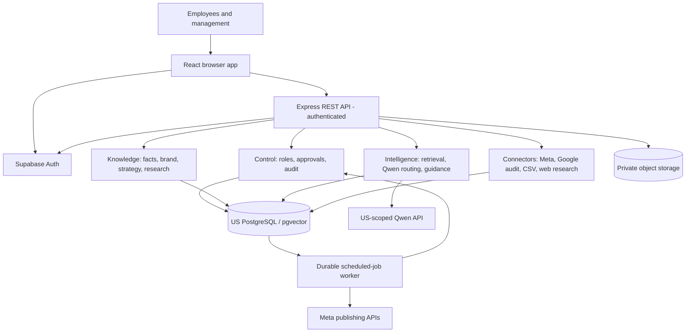
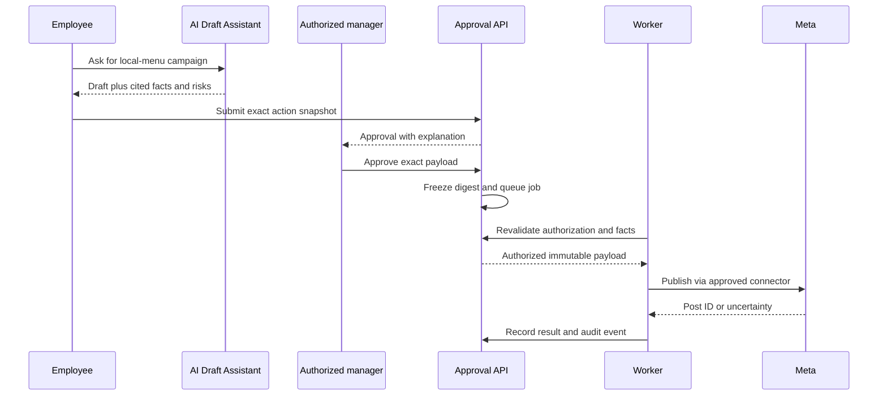

> **Superseded in part (2026-11-13).** Read with [The_Pocket_AI_Architecture_Addendum_v0_4.md](The_Pocket_AI_Architecture_Addendum_v0_4.md), which replaces this document where they differ (Claude instead of Qwen; no embeddings in V1; assisted manual posting; new schedule). This file is kept unchanged below as the project record.

# The Pocket AI Marketing Assistant — Architecture Specification

**Version:** 0.3 — lead designer's proposed baseline  
**Date:** 2026-11-04  
**Status:** **Approved design direction; implementation gated by the verification tasks below.**  
**Source requirements:** *The Pocket AI Marketing Assistant PRD v0.2*, the team's marketing-strategy working document, and the 2026 capstone proposal.  
**Purpose:** A practical, secure architecture for a student-built, browser-based AI marketing application that restaurant staff can use without technical training.

> **Product rule:** Management controls the brand. The marketing strategy establishes the direction. The AI assistant provides expertise and guidance to execute it. AI can draft and recommend; only an authorized human may approve consequential actions.

## 1. Decision and scope

I accept Qwen's general TypeScript/Express/React/PostgreSQL direction **with the corrections in this specification**. Qwen's 2026-11-04 architecture proposal is *not* approved as a database or integration contract as written. This document governs technical architecture; the PRD governs product intent where not superseded by a recorded decision.

### Version-one must work

- Browser-based login and understandable role tiers; Mike and Elliot receive initial administrative invitations after their identities are verified. Admins may invite/revoke others.
- Adaptive management interviews, followed by **review and explicit approval** of structured brand conclusions.
- Persistent, versioned verified facts, approved brand guidelines, approved marketing strategy, licensed/open marketing knowledge, and separately identified AI suggestions.
- Grounded AI conversations with source/date attribution; Flash for everyday tasks, Plus for difficult analysis; research citations, uncertainty, and no fabrication of current menu items.
- Expert guidance for upscale hospitality, relationship marketing, local retention versus visitor discovery, SEO, marketing channels, and **text-based photo-taking instructions** (angles, light, framing, editing recommendations).
- Campaign planning, local/visitor messaging, content drafts, revision history, calendar, scheduled actions, contextual human approvals.
- Instagram professional-account integration with scheduling/approved publishing; Facebook Page connector where the account exists; **real activation depends on authorization and platform prerequisites**. A full mock/test mode is mandatory.
- Manual, reviewed CSV imports for Toast/Tock where a usable export is available; privacy-aware summary KPIs and provenance.
- Google/website discovery audits and human-reviewed suggested improvements; not unapproved Google or CMS updates.
- Exportable, understandable operating documentation: setup, backups, secrets management, account connections, maintenance, and training.

### Explicitly later

Automatic image assessment/editing; general restaurant-operation recommendations outside marketing; live Toast/Tock synchronization; local Gemma deployment; automated Google/CMS modifications; autonomous spend/ad purchases.

### Marketing constraints

One authentic premium brand, **two primary audiences** (locals and regular guests first; tourists/visitors second), and private events as a cross-segment campaign. No unsolicited guest surveys, broad customer profiling by inferred wealth, invented menu claims, or self-authorized promotion. An employee must still own day-to-day marketing.

## 2. Reference deployment — decisive recommendation

| Concern | Decision | Why |
|---|---|---|
| Local development | VS Code, Node.js 24 LTS, TypeScript strict, Docker for local Postgres if needed | Cross-platform and easy for Qwen Code to work with. |
| Frontend | React + Vite + TypeScript + Tailwind, React Router, Zod | Lightweight browser interface. Do not add a second framework without a demonstrated need. |
| API | **Express REST** with Zod request/response validation | Simple, explicit control around sensitive actions. No GraphQL. |
| Database | **Supabase-managed PostgreSQL**, U.S. project, pgvector | One managed location for relational data and search; migrate through tracked SQL files. |
| Authentication | **Supabase Auth**, invitation-based onboarding | Do not implement a separate `password_hash` users table. |
| Private storage | **Supabase Storage**, private buckets, U.S. region | Avoid S3/MinIO complexity initially; use opaque object keys. |
| API/worker hosting | U.S.-region always-on Node service (evaluate Render or Railway); separate worker role in production | Supabase is not the host for a full, long-running Express service. |
| Frontend hosting | Static site on same provider or a simple static host | Prefer same-origin API if convenient; don't over-engineer deployment. |
| Scheduled work | PostgreSQL-backed durable jobs with worker leases | Avoid an extra Redis service initially; publishing cannot rely on a browser tab or sleeping process. |
| Embeddings | **Local, explicitly chosen text embedding model** as privacy-first default; model/dimension must be pinned before migration | Qwen's arbitrary `VECTOR(1536)` is not a design. Avoid uploading entire private documents to an unverified overseas embedding endpoint. |
| AI inference | Qwen `qwen3.8-flash` + `qwen3.7-plus` in a verified **US-scoped** Alibaba Model Studio workspace | Keep region configuration explicit and fail closed if unavailable. |
| Tests | Vitest + Supertest (API), Playwright (user journeys), DB migration/authorization tests | Test behavior and security as code is produced. |
| Logs | Structured, redacted app logs + append-only business audit events | Do not log private interviews, raw customer rows, or OAuth tokens. |

**Do not use:** GraphQL, AWS RDS, a custom password store, MinIO, Redis, Kubernetes, or complex microservices for the first release. Those are not needed to serve one restaurant.

### Architecture diagram

Four **logical components** (Knowledge, Intelligence, Control, Connectors), not four deployed microservices. The API and worker share domain services but have separate launch commands and deployment processes when needed.

## 3. Roles and security boundary

**Admin (Mike/Elliot initially):** Invite/remove staff, choose self-explanatory role, assign permissions, approve/revoke brand rules, authorize channel connections and marketing spending, approve publishing, export appropriately, inspect audit history.

**Approver:** Approve public marketing content and scheduled posts within explicitly assigned channels and limits. Cannot grant administrator authority or edit protected brand policies.

**Contributor:** Interview participation as invited, research, draft content, import permitted sources, propose changes, request approvals, inspect assigned aggregate KPIs. Cannot publish or approve.

**Viewer:** See only approved marketing materials and explicitly permitted reports.

- Use managed `auth.users` identities and application `profiles`/`memberships`. Bootstrap managers via **verified invitation**, not hardcoded production passwords or unverified emails.
- RBAC is enforced by the **server on every route and worker action**, supplemented by PostgreSQL row-level security where data can be reached through Supabase APIs.
- The browser's role display is informational; disabling a button **is not** authorization.
- Permissions should be named capabilities (`brand.approve`, `post.approve`, `channel.connect`, `users.invite`, `data.import`, `data.export`, `analytics.view_sensitive`). Begin with four templates; custom per-user overrides are optional unless management needs them.
- Revocation of users, roles, tokens, approvals, or a social connection must be effective at the next action, including queued posts. Record actor, timestamp, and reason.
- The **AI has no identity authorized for `approve`, `publish`, `invite`, or `spend`**. It can create a draft action request, never an executable command.
- Require recent reauthentication for high-impact actions (account connection, admin grant, sensitive export) if supported. Never disclose service-role keys to the browser.

## 4. Domain data model: what must exist

**Database tables below are logical entities, not instructions to implement 25 tables on day one.** Use consistent UUID primary keys, created/updated timestamps, immutable version records, FKs and restrictive deletes, and a single `restaurant_id` where tenant ownership matters. Even with one restaurant now, explicit ownership protects against accidental cross-tenant data exposure if the application is reused.

| Domain | Entities and necessary fields | Design notes |
|---|---|---|
| Organizations and access | `restaurants`, `profiles`, `memberships`, `role_assignments`, `permission_events` | Supabase Auth owns passwords/tokens; restaurant ID on private resources. |
| Authoritative brand | `brand_interviews`, `brand_proposals`, `brand_rules`, `brand_rule_versions` | Draft interview conclusions separate from *immutable approved* rule versions. Only approved active version governs guidance. |
| Verified facts | `restaurant_facts`, `fact_versions` | Value, source ID, human verifier, verified time, expiry, status. Daily menu and event details can be short-lived. |
| Strategy | `marketing_strategies`, `strategy_versions` | Store editable/approved versions; version ownership and effective period. Strategy is not automatically approved just because it was uploaded. |
| Research | `knowledge_sources`, `source_versions`, `knowledge_chunks`, `source_access` | License/rights, type, version, document hash, trust category, storage reference, verified/approved state, index model/version. |
| AI conversations | `conversations`, `messages`, `recommendations`, `recommendation_sources` | Chat is **not** authoritative memory. Preserve interaction history with retention/access controls; reference source versions used. |
| Campaigns | `campaigns`, `content_items`, `content_versions`, `calendar_entries`, `media_assets` | Content version is immutable; campaign can group local/visitor/event variants. |
| Approval/control | `approval_requests`, `approval_events`, `audit_events` | Typed action, exact canonical snapshot, digest/hash, expiry, requester/approver, evidence and risk context. Never update a signed snapshot. |
| External accounts | `connected_accounts`, `secret_references`, `publish_jobs`, `publish_attempts` | Tokens in encrypted secrets store, not ordinary queryable token text. Retain platform post IDs and uncertain states. |
| Data/KPIs | `import_batches`, `import_mapping_versions`, `import_errors`, `aggregate_metrics`, `kpi_definitions`, `kpi_targets` | Keep actuals, baselines, targets, provenance and estimates distinct. Never indiscriminately keep raw CSV rows. |
| Cost/operations | `ai_usage_events`, `job_events`, `audit_events` | Capture model ID, token usage/cost, source request, job failures, and operator actions without sensitive prompt payloads. |

### Required invariants in the schema

1. **Approved facts and brand rules are append-only versions.** A new approved version may supersede an old one; history remains auditable.
2. `status` alone cannot establish authority: every approved record includes an approving human and timestamp, and is protected from direct unauthorized updates.
3. A recommendation can be `draft`, `proposed`, `accepted_as_campaign`, or `rejected`, but *acceptance as a campaign is not approval of a brand rule*.
4. The RAG index records `embedding_model`, `embedding_dimension`, `source_version`, `classification`, `restaurant_id`, and document rights. Never use a guessed 1536 dimensions.
5. Use `NUMERIC` or integer units for currency/KPI precision; don't indiscriminately use SQL floating-point numbers for financial measurements.
6. Separate KPI **definitions**, **baseline periods**, **targets**, and **actual measurements**. Mark estimated values and absent data explicitly.
7. OAuth token values never appear in the user profile, audit details, errors, analytics, or exported JSON. Use secret references and redact logs.
8. Soft-delete/revoke where records have approval/audit dependencies; cascade delete only clearly ephemeral, non-audited children.

## 5. Knowledge and memory: authoritative retrieval pipeline

### Content types and trust levels

**A. Verified restaurant facts:** current hours, contact, amenity claims, menu items, available events, reservation links; require a source and time of human verification. Food and availability claims need especially short freshness controls.

**B. Management-approved brand/strategy:** interviews distilled into approved principles, brand voice, preferred customer experience, positioning, permitted/prohibited claims, approved team strategy. No AI writes directly to these authoritative collections.

**C. Reference research:** correctly licensed/open marketing textbooks, hospitality marketing, relationship marketing, local marketing/SEO, photographic advice, external competitor and consumer research. Sources may inform advice but *cannot redefine* The Pocket's brand.

**D. Customer insights:** imported **aggregate** trends, known repeat behavior where supported, referral counts, unsolicited reviews where terms permit. Not inferred wealth or unverified local/tourist status.

**E. AI recommendations:** proposals, arguments, alternatives, and uncertainties. Never retrieve as authoritative restaurant facts.

### Document ingestion and retrieval

1. Upload source to a private bucket with filename sanitization, MIME/size allowlists, malware scanning where feasible, hash, ownership, license, and classification. **Upload != approved ingestion.**
2. Extract supported text (PDF/DOCX/Markdown/plain text) and record pages/sections. Restrict external URLs; block internal network metadata/SSRF access.
3. Chunk with meaningful page/heading boundaries and overlap (pilot 400–800 tokens/chunk, tuned by tests); keep title, citation, source version, dates, confidence and access policy.
4. Choose and pin one embedding model and its output dimension. **Privacy-first default:** run a small, permissively licensed text embedding model locally within the backend indexing worker, potentially 384 dimensions, *after benchmarking retrieval quality*. Local embedding costs CPU but does not send full source documents to an unapproved embedding provider. Confirm model license and resources. If the client expressly approves U.S.-scoped hosted embeddings, benchmark as an alternative.
5. Start with PostgreSQL full-text search; add local vector similarity using pgvector and a hybrid ranking over facts, brand, strategy, and reference research. Don't create IVFFlat on an empty dataset by default; benchmark exact search vs HNSW once meaningful volume exists.
6. **Filter BEFORE ranking** by tenant, permissions, current approval status, publication rights, expiry and source version. Never rely on a language model to enforce access control.
7. Retrieve current brand rules + relevant current verified facts explicitly; search additional passages semantically/lexically; use targeted reranking when necessary. Don't blindly restrict all tasks to 3–5 chunks.
8. Package evidence with human-readable `source/title/section/date/approved status`. Retrieved prose is **untrusted data**, not new instructions, even if it says “ignore previous directions.”
9. After generation, validate cited identifiers, current facts, source access and action constraints. If an answer depends on an unavailable current menu, **ask staff to confirm** rather than guessing.
10. Record citation/source-version IDs with recommendations for future review. Updating or revoking a brand rule must remove the obsolete rule from active retrieval and invalidate affected unexecuted actions when material.

### Brand-interview flow

Management starts an interview → assistant asks adaptive questions → system presents **proposed** brand rules with quoted interview support → management edits/approves/rejects → create immutable approved version → future recommendations reference active approved versions. When Mike, Elliot, and ownership disagree, flag the conflict and obtain a human decision. An AI answer never auto-updates this library.

### Conversation memory

Store individual conversations and optional conversation summaries separately from authoritative knowledge. Apply role access and retention rules. Summaries help a dialogue continue; they do not overwrite verified facts or approved strategy. Summarize old threads to manage token use, and always retrieve the stable source of truth separately.

## 6. AI service, routing, grounded recommendations

### Provider abstraction

Use typed task names: `brand_interview`, `brand_rule_extract`, `marketing_question`, `campaign_plan`, `content_draft`, `seo_audit`, `photo_taking_guide`, `research_synthesis`, `performance_summary`.

- Routine tasks use **`qwen3.8-flash`**; complex brand interviews, conflicting evidence and nuanced strategy use **`qwen3.7-plus`**.
- For Alibaba Model Studio, create a **US (Virginia) workspace with explicit US inference scope**, then verify model availability and API behavior with test calls. The old `-us` naming convention is deprecated for new workspaces. Never substitute a Global workspace automatically. “US Virgin Islands” is *not* the correct regional designation.
- The Plus model's U.S. capabilities may differ from its Global capabilities. Use tool/function calling where verified; **always validate model output with Zod and safely retry/reject** rather than assuming a guaranteed JSON mode.
- Built-in provider web search is not universal across model/region combinations; use a separately governed search connector with citations and query sanitization.
- External-model prompts contain only minimal relevant approved and redacted text. Private interview content may only be sent after client authorization and review of data-handling terms. No raw Toast/Tock exports or guest identifiers in model prompts.
- Each invocation records model, scope, token usage, estimated cost and task type. Cap context length, concurrency and spend; stop/ask for approval when a budget threshold is reached.
- No automatic fallback across model providers or regions; when appropriate an explicitly approved alternative **within US scope** could be added later.
- Reserve API tools for **read-only retrieval and draft creation**. The language model does not receive a direct social-publish, account-connect, permission-grant, or brand-approve tool.

### Structured recommendation contract

For a campaign proposal, require:

`audience`, `goal`, `channel`, `approved_brand_rule_ids`, `verified_fact_ids`, `source_citations`, `draft_content`, `why_this_fits`, `what_employee_must_confirm`, `risks`, `estimated_time_cost`, `success_metrics`, `confidence_and_uncertainty`, `status='draft'`.

Every user-visible citation must resolve to a real, authorized source record. Avoid attributing increased reservations or ROI to clicks without evidence.

## 7. Approval and publishing: safety-critical design

The unit of approval is a **typed action snapshot**, not an editable campaign row or mutable caption.

### Publish action snapshot includes

- Action type (`publish_social_post`); restaurant ID, channel/provider, destination/account external ID.
- Exact rendered caption, media file ID **and immutable media checksum**, crop/format where applicable, link/hashtags, audience restrictions if applicable.
- Exact scheduled timestamp and timezone; campaign/content version, approver, expiry and any perishable menu confirmation expiry.
- Current strategy and brand-rule version references, supporting facts, current verification status.
- Stable canonical serialization and a SHA-256 digest so approval is provably bound to the payload.

### State machine

`draft -> pending_review -> approved -> queued -> executing -> published`  
Alternative transitions: `pending_review -> rejected`; `approved/queued -> revoked/expired/cancelled`; `executing -> uncertain/failed`; `uncertain -> reconciled_published/reconciled_not_published/manual_review`.

**Editing caption, image, destination, or scheduled time creates a NEW version and a NEW approval.** Do not silently repurpose the previous approval. Manager-edit action must return to a review screen; editing isn't itself authorization.

### Approval example (plain English)

> **Proposed:** Instagram photograph of a verified seasonal dish at 4:00 p.m.  
> **Why:** Local-retention campaign highlighting that the menu changes.  
> **Verified facts:** Dish name confirmed by kitchen at 11:00 a.m.; brand principle #12 approves this tone.  
> **Please confirm:** Dish is still available; photograph is accurate.  
> **Risk:** Menu could change before posting; misleading availability would damage credibility.  
> **Actions:** Approve exactly as shown / Edit and request a new review / Reject / Ask for explanation.

### Durable executor

1. Request is created, validated and approved on server by an authorized human.
2. A job referring to the **immutable approval ID/digest** is queued in the same database transaction where relevant.
3. At dispatch, worker rechecks current permissions, approval validity, connected account, fact/availability expiry, exact hash, and whether destination already has a recorded successful post.
4. The **deterministic connector code**, not AI, calls Meta. Store provider object IDs and status.
5. Use a unique logical key for `(restaurant, platform, account, approved_action)` and DB leases/locking to prevent two local workers executing the same action.
6. On timeout after a request might have succeeded, enter `uncertain`; attempt platform reconciliation if supported. **Never blindly retry an ambiguous publish response** and accidentally double-post. Exactly-once delivery by a third-party API cannot be guaranteed; design for best-effort duplicate prevention and human reconciliation.
7. Log retries/failures and notify management. Preserve human-readable status, ability to cancel future posts and approved-post history.

## 8. Social, Google, web research and CSV integration contracts

### Instagram and Facebook

- Instagram **professional** account is required for supported publishing; the client has an account but its classification remains unverified.
- Evaluate **Instagram Login** (can be professional-account integration without presuming a Facebook Page) and **Facebook Login** (requires linked Facebook Page for that flow). These have *different permissions*. Do not label Instagram Login as “consumer login.”
- Instagram media publishing requires supported media containers and captions; Qwen's `publishCaption()` method is not a valid generic API abstraction for a text-only Instagram post. Implement supported media posting, account checks, media URL availability, polling/status checks, and channel-specific payload validation.
- Implement an **OAuth connection state**, short-lived state/PKCE as supported, secure redirect validation, encrypted token storage, disconnect/revoke, scope review, expiry/refresh, and an explicit capability matrix by platform. Never ask management to send account passwords.
- Facebook Page is presently unconfirmed; connector should remain disabled until a Page is created and access granted.
- Separate **mock tests** from **real platform tests**. Test mode does not establish client production approval. App review, permissions, business verification and quotas may delay live posting.

### Google / SEO

- V1: audit public discovery and approved business details, explain likely inconsistencies, draft website/Google Business Profile correction instructions, track what employee corrected.
- Business Profile authorization uses `https://www.googleapis.com/auth/business.manage` where API access is obtained. Google search snippets are not all directly editable from Business Profile. No automatic external changes without approval, verified access, and new explicit scope.
- Website CMS is unknown. Do not claim a connector can publish corrections until platform and admin permissions are verified.

### CSV imports (Toast, Tock)

- Manual CSV import in V1 with schema-mapping wizard, preview, validation, rollback/re-import protection, provenance, and aggregated result summaries.
- Data handling: parse raw rows temporarily in a restricted import process; avoid persisting raw rows by default. Allow management-approved retention if necessary with defined purpose and deletion period. Store anonymized/aggregated counts.
- For repeat-reservation analysis, **irreversible anonymization of every row may prevent matching repeat visits**. If necessary, derive keyed pseudonymous identifiers (HMAC using a secret) in the restricted importer, then store only the keyed value and aggregate metrics. Document limits and get client authorization.
- Never send guest names, email addresses, phone numbers, or unredacted reservation notes to Qwen or web search. No unsolicited surveys or customer outreach.

### Web research

Use an approved search tool with citations, source-date fields and a user-visible distinction between *third-party claim* and *verified Pocket fact*. Strip restaurant secrets and guest information from search queries; restrict fetch URLs to prevent SSRF. Do not ingest copyrighted textbooks en masse; record open licenses and attribution.

## 9. User interface built for nontechnical staff

Home screen should have five simple tasks rather than a complex AI-agent control center:

1. **Ask the marketing assistant** — grounded answers with expandable sources and a clear suggested next step.
2. **Create a post or campaign** — choose locals/visitors/events, verify current details, draft, revise, submit for approval.
3. **Review and approve** — one card per action; *what/why/evidence/risks/missing confirmation/cost* and exact preview.
4. **Plan and measure** — calendar, scheduled posts, platform status, simple dashboard, known/unknown reservations and referrals.
5. **Manage The Pocket's knowledge** — approved brand rules, facts, strategies, sources, interview, employee access (visible by role).

Large readable buttons, explicit states, no jargon-heavy settings, helpful error messages, and an audit trail management can understand. A new contributor should complete a draft-to-approval workflow with little explanation. UI may display photo-taking advice in V1; photo uploading for automatic aesthetic analysis is **V2**.

## 10. Measurement, operating cost and privacy gates

**KPIs with baselines and provenance:** local retention and repeat reservations; tourist/visitor discovery (only when distinguishable); referrals from Inn/hotels; event inquiries/bookings; content hours/minutes; approval accuracy and revisions; reach/engagement separated from reservations; operating cost per period. Tag estimates explicitly and do not claim causal revenue lift from a post unless appropriately measured.

**Cost dashboard:** AI input/output tokens by model; local embedding CPU usage; database/storage/egress; hosting/API uptime; worker operations; web search; transactional email; backups; social API/app review costs if any; domain; training and ongoing maintenance. Budget ranges: attempt a low-cost pilot, **$100–$200/month target**, explore **up to $400/month** with itemized justification; do not promise totals before usage and platform quotes.

**Privacy checklist before real client data or secrets:** written management permission; U.S.-scoped model workspace validated; provider data terms reviewed; private object storage; consent/source rights; retention/deletion/export policy; credential encryption; access controls tested; production backups and restore tested; rate limits; malware/file validation; dependency audit; relevant consumer-data and platform policy review.

## 11. Corrected implementation order and acceptance gates

**Do not use Qwen's eight-week backend-first estimate.** The remaining capstone window is shorter. Prioritize a working vertical slice and then expand; all live integrations remain conditional on external approval. Schedule dates are targets, not representations of completed work.

| Stage | Target window (tentative) | What Qwen implements | Definition of done |
|---|---|---|---|
| 0. Design verification | Immediately | Confirm tech packages, hosting deployment, actual US model IDs, Meta OAuth options, embedding model/dim, PRD conflicts; architecture files in Markdown | No unverified assumptions; product owner signs off on provider and scopes. |
| 1. Foundation | Nov. 4–9 | Repo, env sample, typed API, Supabase local config/migrations, Auth integration, role templates and deny-by-default authorization, audit service | Test accounts; a contributor cannot approve or access admin data. |
| 2. One full vertical slice | Nov. 9–14 | Interview → proposed brand rule → manager approval → source retrieval → AI draft recommendation → content version → contextual approval in a minimal browser UI | End-to-end with mock model and mock social connector, verified by Playwright and API tests. |
| 3. Real AI and richer marketing | Nov. 14–20 | US-scoped Qwen clients, prompt data minimization, document ingestion, local embeddings/hybrid retrieval, real sources, research connector, local/visitor campaign, text photo guidance | Grounded outputs cite permitted sources; no invented menu item; budget and privacy checks work. |
| 4. Scheduling, integrations and metrics | Nov. 20–27 | Durable publish worker, Instagram authorization flow (or test-account integration), Facebook stub, Toast/Tock CSV import preview, KPI dashboard, Google manual audit | Published content cannot deviate from approval; duplicate/uncertain handling tested; imports don't leak PII. |
| 5. Validation, training and handoff | Late Nov.–early Dec. | Usability walk-through with management, backup restore, permissions audit, technical README, admin guide, cost estimates, final feature/status report | Clearly mark *working in test*, *live connected*, *blocked by client/platform*, and *deferred*. |

A **minimal React UI must appear during Stage 2**, not after all backend features. Run tests throughout, not only in a final hardening week. If one stage slips, preserve safety and the vertical slice first; do not misrepresent blocked or unimplemented features.

### Non-negotiable acceptance scenarios

1. Contributor cannot publish, connect a channel or create an admin.
2. An AI recommendation never edits approved brand principles.
3. Manager modifies a caption after approving it → prior approval cannot publish modified content.
4. Scheduled post's dish fact expires → worker blocks and requests human re-verification.
5. Two workers process same logical post → only one publish attempt is authorized; ambiguous platform response enters manual reconciliation instead of a blind retry.
6. Removed manager authorization or revoked OAuth token blocks queued execution.
7. RAG answer retrieves approved brand rules and current facts, not stale drafts or cross-user confidential data.
8. A malicious uploaded source saying “ignore permissions” cannot influence executor permissions.
9. CSV import containing guest names produces a safe aggregate KPI and no names in model requests/logs.
10. User sees clear difference between measured bookings and speculative social-media impact.
11. U.S.-only model configuration fails closed if no approved U.S.-scoped endpoint is available.
12. Restore test proves documents, approved rules, audit events and database can be recovered.

## 12. Open decisions / owner confirmation

**Already decided by lead designer for the initial architecture:** Supabase-managed Postgres/Auth/Storage; TypeScript REST; React; PostgreSQL-backed worker; manual CSV first; no Gemma runtime in V1; mock Meta first; U.S.-scope first; no auto-Google changes; no custom password handling.

**Verification gates, not user-preference questions:**

- Verify specific U.S.-workspace and pricing/model capability configuration by real test request. Published model docs show U.S. model support but do not prove account provisioning or regional data policy for this client.
- Verify Qwen provider credentials are kept server-side and data terms approved before submitting confidential restaurant knowledge.
- Verify embedding model license, CPU cost and retrieval quality. Choose and lock dimension *before* generating vector migrations.
- Inspect current client Instagram account type and Meta app prerequisites; do not claim production publishing until authorized and demonstrated.
- Obtain confirmed client information on website CMS, authorized Google Business Profile, CSV export structure, and actual user/usage levels.
- Clarify who maintains production hosting and whether the manager wants self-approval for their own drafts (admin may approve own draft through explicit click by default; more restrictive two-person review can be added for sensitive activities).

## 13. Academic and contribution record

The marketing problem, evidence, strategy, and many recommendations are team work. Record the user's implementation and architecture/design-review contributions accurately, including AI tool assistance, testing, and code review. Do not claim code the user did not implement or tests not run. Maintain `docs/DECISIONS.md`, `docs/TEST_LOG.md`, `docs/AI_ASSISTANCE.md`, and a user-facing README, in Markdown, following applicable course AI-use disclosure rules.

## Technical source references (checked 2026-11-04)

- Alibaba US regions and inference scopes: https://www.alibabacloud.com/help/en/model-studio/usa-virginia-global
- Alibaba U.S. workspace deployment migration: https://www.alibabacloud.com/en/notice/product_change_change_announcement_for_model_studio_us_virginia_workspace_deployment_mode_876
- Alibaba model capabilities and prices: https://www.alibabacloud.com/help/en/model-studio/qwen3-8-flash ; https://docs.modelstudio.console.alibabacloud.com/en/model-studio/qwen3-7-plus ; https://www.alibabacloud.com/help/en/model-studio/model-pricing
- Embedding options: https://www.alibabacloud.com/help/en/model-studio/embedding
- Supabase managed Auth, database and pgvector: https://supabase.com/docs/guides/auth ; https://supabase.com/docs/guides/database/extensions/pgvector ; https://supabase.com/docs/guides/ai/hybrid-search
- Official Meta API collection: https://www.postman.com/meta/instagram/documentation/6yqw8pt/instagram-api ; https://www.postman.com/meta/instagram/folder/1z5vxzu/instagram-api-with-instagram-login
- Google Business Profile OAuth: https://developers.google.com/my-business/content/implement-oauth
- Render durable worker deployment: https://render.com/docs/background-workers
